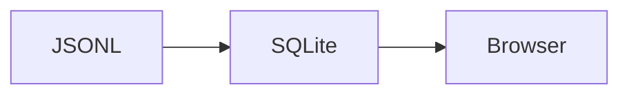
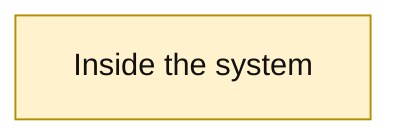

# Agent Sessions Viewer

A local web interface for reading Codex and Claude Code session transcripts and
ordinary Markdown documents. It renders user and assistant messages as
Markdown, remains responsive with very long conversations, and can follow an
active session as new messages arrive.

The application has four small pieces:

- FastAPI discovers transcripts and incrementally indexes visible messages.
- SQLite stores the rebuildable message index and durable annotations.
- React renders only the part of a conversation currently being viewed.
- Vite's preview server serves the built frontend and forwards API requests.

Markdown documents are read directly from a separate directory. They are not
copied into SQLite or converted into fake conversations.

Contributors and coding agents: see [docs/REPOSITORY_MAP.md](docs/REPOSITORY_MAP.md)
for where everything lives.

Transcript files remain the source of truth. The viewer only reads them and
never modifies them. Conversation archives created explicitly from the
UI or CLI use a separate writable directory.

## Requirements

- [uv](https://docs.astral.sh/uv/) (it provides Python 3.14 for the backend)
- Node.js and npm for the frontend
- [`just`](https://just.systems/) to run the project commands
- A directory containing Codex and/or Claude Code JSONL session files
- A modern web browser
- Optional: Python 3.10 or newer for the host-side title and counting scripts

## Common session locations

The tools normally store their JSONL session files beneath these directories:

| Tool | Common default directory |
| --- | --- |
| Codex | `$HOME/.codex/sessions` |
| Claude Code | `$HOME/.claude/projects` |

These are conventional defaults, not paths hard-coded by the viewer. Use the
actual locations on your machine if either tool has been configured with a
different home directory.

`$HOME` above is shell notation for your user home. In `config/sources.toml`,
use the expanded absolute path, for example `/Users/me/.codex/sessions`. The
viewer does not expand `~` or `$HOME`.

## Quick start

Create the local configuration and install the frontend dependencies:

```bash
just setup
```

This creates `.env` and `config/sources.toml` from the documented examples
without overwriting existing files. Both are gitignored, so machine-specific
paths and source names will not be committed.

### Example: one Codex sessions directory

Suppose the only sessions you want to track are beneath:

```text
/Users/me/.codex/sessions/
├── 2026/
│   └── 09/...
└── ...
```

Point one source at that directory in `config/sources.toml`:

```toml
[[sources]]
id = "personal"
adapter = "codex"
path = "/Users/me/.codex/sessions"
```

### Example: several session directories

Add one `[[sources]]` block per directory:

```toml
[[sources]]
id = "personal"
adapter = "codex"
path = "/Users/me/.codex/sessions"

[[sources]]
id = "work"
adapter = "codex"
path = "/Users/me/.codex-work/sessions"

[[sources]]
id = "claude"
adapter = "claude"
path = "/Users/me/.claude/projects"
```

Here:

- A **source** is one configured directory tree containing session JSONL files.
  It has a stable label, one transcript-format adapter, and one path. A source
  can contain any number of sessions recursively; it does not mean one session
  and does not have to mean one account.
- `id` is a label chosen by you. It is displayed in the viewer and is not an
  account name. Keep it stable because it becomes part of the indexed session
  identity and browser preferences.
- `adapter` selects the transcript format: `codex`, `claude`, or the viewer's
  own `archive` format.
- `path` is a host path, either absolute or relative to the `config/` directory.
  The built-in archive source uses `../archives`, the repository's `archives/`
  directory. Discovery searches each path recursively for supported JSONL files.

### Start the viewer

```bash
just up      # build the frontend, then start the viewer in the background
just open    # open http://127.0.0.1:41730 in the default browser
just down    # stop it
```

The first page load discovers available sessions. Select one and press **Index
session** to import its visible messages. Enable **Watch** only when you want
the open session to follow new messages.

- `just up` runs `scripts/run_viewer.sh` in the background: the backend (uvicorn)
  on `VIEWER_API_PORT` and Vite's preview server on `VIEWER_PORT`, which serves
  the built frontend and forwards `/api` to the backend. Both bind to
  `127.0.0.1`. The defaults are `41730` and `41731`; override either in `.env`.
- The output of both servers goes to `data/viewer.log` (`just logs` follows it).
  If either server exits, the other one is stopped too.
- The viewer stops when the computer restarts. Run `just up` again afterwards.
- `just serve` runs the same thing in the current terminal until Ctrl-C.
- Vite accepts `*.ts.net` host names, so `just tailscale-serve` (port 80 of the
  tailnet name → `VIEWER_PORT`) reaches the running viewer from a phone on the
  tailnet. It refuses to start when the viewer isn't answering.

After changing `.env`, `config/sources.toml`, or the application code, run
`just restart`.

## Command shortcuts with `just`

The checked-in `justfile` provides short names for routine commands. Running
`just` without arguments prints the complete command list with descriptions.

First-time setup and startup:

```bash
just setup       # Create missing config and data directories, install frontend dependencies
# Edit config/sources.toml (and optionally .env) now.
just up          # Build the frontend and start in the background
```

Daily operation:

```bash
just status      # same as just health
just logs
just restart
just down
just serve       # run in this terminal instead of the background
just open
just tailscale-serve
```

Discovery and indexing:

```bash
just discover
just sources
just discover-source personal
just sync personal 019fdbaf
just archive personal 019fdbaf-c2ea-7e50-ae8f-8fa79e733904
```

Validation and utilities:

```bash
just test
just test-backend
just test-frontend
just title-list
just title-set 019fdbaf-c2ea-7e50-ae8f-8fa79e733904 "Codex frontend UI"
just title-remove 019fdbaf-c2ea-7e50-ae8f-8fa79e733904
just count /absolute/path/to/session.jsonl
just count-as claude /absolute/path/to/session.jsonl
```

## Discover and read sessions

Opening the viewer runs discovery automatically. Discovery catalogs session
metadata but does not import every conversation, which keeps startup fast even
when the source root contains many sessions.

The main workflow is:

1. Use **Rescan** in the sidebar when a new session does not appear.
2. Select a session.
3. Press **Index session** the first time it is opened.
4. Use **Sync now** for a one-time update or enable **Watch** for the active
   conversation.

The sidebar is ordered by latest activity and grouped by day. Its collapse
state is remembered by the browser.

The same operations are available from the command line. A source ID and a
complete session UUID or unique UUID prefix identify a session:

```bash
just sources
just discover
just discover-source personal
just sync personal 019fdbaf
just sync claude 087e7ac1
```

## Read Markdown documents

The viewer reads the directory selected by `VIEWER_DOCUMENTS_ROOT` and never
writes to it. The default is the gitignored `documents/` directory beside this
README:

```dotenv
VIEWER_DOCUMENTS_ROOT=./documents
```

Copy any number of UTF-8 `.md` files into it. Nested directories are supported:

```text
documents/
├── architecture.md
├── notes/
│   └── ollama.md
└── reviews/
    ├── backend.md
    └── frontend.md
```

Open **Documents** in the sidebar and press the refresh icon after adding,
renaming, or removing files. Each file is a separate document. Its first H1 is
used as its display title, with the filename as the fallback.

Opening a document reads that file directly from disk and renders the complete
document as one continuous page. The browser caches the loaded Markdown for the
current SPA session; **Reload** explicitly reads the file again. Documents use
the same headings, outline, Mermaid diagrams, mathematical notation, syntax
highlighting, raw HTML, and copy buttons as conversation messages.

Documents are never written to SQLite and require no discovery, indexing, or
synchronization command. The API only lists filesystem metadata and returns the
selected file. To use a different directory, set an absolute host path in
`.env`, then run `just restart`:

```dotenv
VIEWER_DOCUMENTS_ROOT=/Users/me/Documents/markdown-library
```

## Archive a conversation

**Archive** writes the selected conversation to the viewer's stable JSONL
format. It exports only messages already present in SQLite, so press **Sync
now** first when the source may have newer messages. Export is explicit: Watch
and normal synchronization never write archives.

By default archives are written to the gitignored `archives/` directory. To
store them in a backed-up location, put an absolute host path in `.env`:

```dotenv
VIEWER_ARCHIVES_ROOT=/Users/me/Documents/agent-conversation-archives
```

Keep this source in `config/sources.toml`, pointing at the same directory, so
exported files can be discovered and viewed like any other session. With the
default directory:

```toml
[[sources]]
id = "archive"
adapter = "archive"
path = "../archives"
```

From the UI, open an indexed session and press **Archive**. The confirmation
shows how many currently indexed messages will be written. From the command
line, use the full session ID:

```bash
just archive personal 019fdbaf-c2ea-7e50-ae8f-8fa79e733904
```

The result atomically overwrites `archives/<session-id>.jsonl`. A file contains
one versioned session header, ordered user/assistant Markdown messages, and a
final message count plus SHA-256 checksum. The archive adapter verifies that
footer before importing; a truncated or edited file fails loudly. Tool calls,
tool results, hidden reasoning, and injected context are intentionally absent,
because archives preserve the readable conversation rather than the vendor's
complete execution log.

After the first export, press **Rescan** (or run `just discover-source archive`),
then open and index the copy under the `archive` source. The original and the
archived copy remain separate because source ID is part of session identity.

## Give sessions custom titles

The viewer normally derives a title from the transcript. Click the pencil next
to the open session title to replace it directly. **Save** applies the title
immediately to the header and sidebar, Escape or **Cancel** discards the edit,
and **Reset** restores the title derived from the transcript.

Titles are stored atomically in the host file
`metadata/session_metadata.json`, apart from `config/sources.toml`.
Consequently titles survive browser changes, restarts, and rebuilding the
SQLite index.

The command-line helper edits the same file. Copy the complete session ID from
the session header and run:

```bash
./scripts/session_title.py set \
  019fdbaf-c2ea-7e50-ae8f-8fa79e733904 \
  "Codex frontend UI"
```

Click **Rescan** in the viewer after a command-line change. Browser edits update
the current catalog immediately and do not require a rescan.

List all custom titles:

```bash
./scripts/session_title.py list
```

Remove a custom title and return to the transcript-derived title:

```bash
./scripts/session_title.py remove \
  019fdbaf-c2ea-7e50-ae8f-8fa79e733904
```

The script updates `metadata/session_metadata.json` atomically. A different
metadata file can be selected by placing `--file PATH` before the command.

The underlying format is intentionally simple:

```json
{
  "019fdbaf-c2ea-7e50-ae8f-8fa79e733904": {
    "title": "Codex frontend UI",
    "hidden": true
  }
}
```

The JSON format remains deliberately simple. A title is scoped by session UUID,
so an original and archived copy with the same UUID receive the same custom
title. The eye action beside a session hides it from the normal sidebar without
deleting its transcript or index; the crossed-eye button in the sidebar opens
the hidden-session window and allows it to be restored. This preference is also
stored in the same metadata object as `"hidden": true` and therefore applies to
every source copy with that session UUID. Live message bookmarks and their
labels are stored in the current browser's local storage. They can also be
exported as durable snapshots from the viewer.

## Reading controls

- **Beginning** and **Latest** move to either end of the session.
- Enter the displayed message number in the **# / Go** control to jump directly
  to that message.
- The star in a message header adds or removes a bookmark.
- **Bookmarks** opens the saved-message list. Bookmark labels are generated
  from message text and can be edited in place.
- Select rendered text in a message or document to reveal a small **Annotate**
  action, then click it to open the note editor. Casual selections are harmless:
  the action disappears on outside click, Escape, or scrolling. The saved
  annotation records the exact quotation, surrounding text, and its Markdown
  source lines without changing the JSONL or `.md` file.
- **Annotations** opens a side panel listing the notes for the current session
  or document, grouped by message, with the full quotation and the headings it
  sits under. **Jump** loads and expands the message when necessary, then jumps
  to and briefly emphasizes the annotated passage. Notes can be edited or deleted
  in place. Tick notes individually, or tick a message's checkbox to select all
  of its notes at once (two messages are two clicks); **Copy selected** and
  **Delete selected** act on the whole selection, and deleting asks for
  confirmation once. See
  [Copy annotations for an agent](#copy-annotations-for-an-agent).
- **Export backup** atomically overwrites `bookmarks/<session-id>.json` with the
  current list. **Restore backup** confirms and then replaces the browser list
  directly; it does not scan or synchronize the transcript.
- **Fold**, **Collapse all**, and **Expand all** control long message bodies.
- **Archive** atomically exports the currently indexed conversation; it does
  not synchronize the source first.
- Messages with at least two headings have an **Outline** button. The outline is
  closed by default and provides quick jumps within that message.
- Rendered messages substantially taller than the viewport have a compact
  **Top of message** action at their bottom.
- The session ID, complete message Markdown, and every fenced code block have
dedicated copy buttons.

In document mode, **Beginning**, **End**, **Outline**, **Copy**, and **Reload**
operate on the complete Markdown file. **Top of document** is available at the
bottom of the page.

Press **Ctrl+F** or **Cmd+F** to search the complete indexed conversation—not
just the messages currently rendered on screen. Enter and Shift+Enter move
between matches, and Escape closes search.

Fold state, live bookmarks, bookmark labels, sidebar state, and Watch
preferences are stored in browser local storage. Bookmark backups are readable,
versioned JSON files in the gitignored `bookmarks/` directory. Annotations are
stored in SQLite so they are shared across browsers and survive session resyncs.
None of these mechanisms modifies transcript or Markdown source files.

## Copy annotations for an agent

Each annotation can be copied as Markdown to paste into an agent for a
follow-up. **Copy** on a note copies that one; **Copy group** copies every note
on a message; tick the checkboxes and use **Copy selected**, or use **Copy all**.
One annotation is copied as:

````markdown
**Message #12**
## Heading
### Subheading
> the quoted passage

your note
````

- The first line names the message (`Message #N`) or document. The heading lines
  are the headings the passage sits under, in order, taken from the Markdown
  source. Several annotations are separated by `---` and each repeats its own
  headings.
- The quotation is the Markdown source, not the rendered text, so formulas and
  code survive. Prose you selected is quoted exactly as selected. A selection
  that includes math, bold, links, or other inline formatting is quoted as its
  whole source line or block. Math is kept as `$$ ... $$`. A selection inside a
  fenced code block is copied as a fenced block with its language.
- Source and headings are saved when the annotation is created. Annotations saved
  earlier get them filled in on read while the message or document is unchanged;
  otherwise the panel shows and copies the rendered text.

## Markdown rendering

User messages, assistant messages, and standalone documents share the same
GitHub-flavored Markdown pipeline. The viewer supports headings, lists, tables,
task lists, blockquotes, links, inline code, fenced code, and raw HTML.
Recognized fenced-code languages receive syntax highlighting.

TeX-style mathematics is rendered with KaTeX. Use single dollar delimiters for
inline notation and double dollar delimiters for a display equation:

```markdown
Einstein's relation is $E = mc^2$.

$$
\int_{-\infty}^{\infty} e^{-x^2}\,dx = \sqrt{\pi}
$$
```

Long display equations scroll horizontally instead of widening the message.
Inline code and fenced code are never interpreted as mathematics. Escape a
literal paired dollar sign as `\$` when it could otherwise look like math.

Headings receive message-scoped anchors, with a small `#` link visible only on
hover. Ordinary same-document Markdown links are resolved inside their own
message without conflicting with identically named headings elsewhere in the
conversation. This lets Codex refer naturally to another section of a long
answer:

```markdown
Implementation details are under [Architecture](#architecture).

## Architecture
...
```

The viewer's **Outline** control already provides a table of contents. These
anchors navigate the currently rendered message; durable links that reopen a
session at a specific heading are not yet part of the URL scheme.

The renderer also preserves Markdown AST line positions for annotations. For
ordinary prose it narrows a selection to the exact source lines when the
rendered quotation can be found in the Markdown; complex formatted selections
fall back to their containing Markdown blocks. The exact quotation and nearby
text are retained as additional anchors. If a standalone document changes, the
viewer first searches for that quotation and falls back to the recorded source
line when it can no longer be found.

A fenced block tagged `mermaid` is rendered as a Mermaid diagram:

````markdown

````

Use **Raw** in a diagram toolbar to switch between the rendered diagram and its
original Mermaid source. Invalid diagrams display their error and source instead
of disappearing. Generated SVG labels are not annotatable, but text selected in
the diagram's **Raw** source is.

When a diagram declares styled classes with `classDef`, the viewer adds a
compact legend beneath the rendered SVG. The class name is used as its label and
the badge reflects its `fill`, `stroke`, and `color` properties:



The legend is derived without changing the Mermaid source or graph layout. It
is shown only in diagram mode and only when styled classes are present.

Raw HTML is not sanitized because this is a single-user viewer for trusted
local transcripts. Both servers bind to `127.0.0.1`. Do not expose this
application publicly or use it for untrusted transcript files.

## Synchronization and stored data

The first sync reads the selected transcript. Later syncs start at the last
completely processed byte and inspect only appended JSONL records. Repeating a
sync is safe, and truncating or replacing a transcript rebuilds only that
session.

**Watch** polls the open session every two seconds. It does not scan or import
other sessions in the background. When the viewer is already at the end, new
messages remain in view. When reading earlier messages, an indicator appears
beside **Latest** instead.

Only visible user and assistant text is indexed. Metadata, injected context,
reasoning, tool calls, tool results, attachments, and other non-conversation
records are excluded.

SQLite lives in the gitignored `data/viewer.sqlite3`. The session catalog and
messages inside it are rebuildable indexes, but saved annotations are user data
and cannot be reconstructed from the JSONL transcripts. Restarts and rebuilds
keep the file. Back it up before deleting it if annotations matter to you.

Conversation archives live in the writable directory selected by
`VIEWER_ARCHIVES_ROOT` (`./archives` by default). Unlike SQLite, these are
intended as durable, vendor-neutral conversation copies. Back that directory up
if the exports matter to you.

Standalone Markdown files remain solely in the read-only directory selected by
`VIEWER_DOCUMENTS_ROOT`. Only their contents currently displayed by the SPA are
kept in browser memory; neither their metadata nor content is stored in SQLite.

Session title metadata lives in the writable host directory selected by
`VIEWER_METADATA_ROOT` (`./metadata` by default). `just setup` moves an existing
`config/session_metadata.json` into this directory once, preserving titles from
older installations, and creates an empty metadata file for new installations.

## Useful operational commands

Check whether the viewer is running:

```bash
just status
```

Follow the backend and web-server log of a viewer started with `just up`:

```bash
just logs
```

Rebuild and restart after changing application code or configuration:

```bash
just restart
```

Stop the viewer without deleting the SQLite index:

```bash
just down
```

Delete and rebuild all SQLite data only when intentionally starting over. This
also permanently deletes saved annotations:

```bash
just down
rm data/viewer.sqlite3
just up
```

## Troubleshooting

### No sessions appear

Run discovery directly and inspect its error:

```bash
just discover
just sources
```

`just sources` prints every configured path and whether it exists. Each path in
`config/sources.toml` must be absolute or relative to `config/`; the archive
source should point at the archives directory (`../archives` by default). For
errors from the running viewer, see `just logs`.

### A session exists but has no messages

Select it and press **Index session**. The catalog and message index are
separate on purpose. Also remember that tool-only and metadata records are not
displayed as messages.

### Markdown documents do not appear

Switch to **Documents** and press its refresh icon. `.md` files must be beneath
the directory set by `VIEWER_DOCUMENTS_ROOT` (`documents/` by default). Files must
be UTF-8 to open successfully.

### Compare a JSONL transcript with SQLite

The diagnostic script counts messages using the same adapter rules as the
backend:

```bash
./scripts/count_session_messages.py /absolute/path/to/session.jsonl
```

Select an adapter explicitly only when automatic detection is insufficient:

```bash
./scripts/count_session_messages.py --adapter codex /path/to/session.jsonl
./scripts/count_session_messages.py --adapter claude /path/to/session.jsonl
./scripts/count_session_messages.py --adapter archive /path/to/archive.jsonl
```

Its `visible messages` value is the count expected in SQLite after a successful
sync. `jsonl lines` is larger because one transcript contains many kinds of
records.

### The browser still shows an older frontend

After `just restart`, reload the page so the browser fetches the new hashed
JavaScript and CSS assets.

## Development and tests

Run the backend suite, frontend lint, and the production TypeScript/Vite build:

```bash
just test            # or just test-backend / just test-frontend
```

The same checks without `just`:

```bash
cd backend
uv run --group dev pytest

cd ../frontend
npm ci
npm run lint
npm run build
```

## HTTP API

The React frontend uses these endpoints:

```text
GET  /api/health
GET  /api/documents
GET  /api/documents/{document_id}
GET  /api/documents/{document_id}/annotations
POST /api/documents/{document_id}/annotations
GET  /api/sessions
POST /api/sessions/discover
GET  /api/sessions/{source_id}/{session_id}
GET  /api/sessions/{source_id}/{session_id}/messages?start=0&limit=30
GET  /api/sessions/{source_id}/{session_id}/search?q=substring
GET  /api/sessions/{source_id}/{session_id}/annotations
POST /api/sessions/{source_id}/{session_id}/annotations
POST /api/sessions/{source_id}/{session_id}/sync
POST /api/sessions/{source_id}/{session_id}/archive
PUT  /api/sessions/{source_id}/{session_id}/title
DELETE /api/sessions/{source_id}/{session_id}/title
PUT  /api/sessions/{source_id}/{session_id}/visibility
PATCH /api/annotations/{annotation_id}
DELETE /api/annotations/{annotation_id}
```
